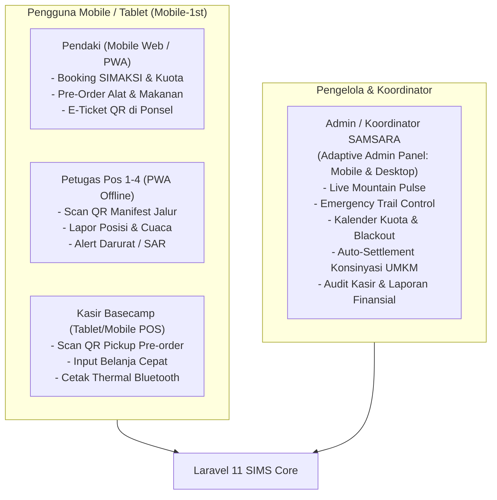
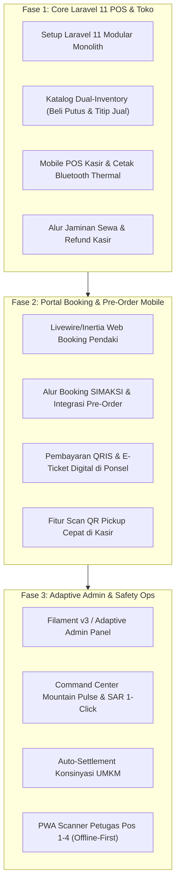

# Product Requirement Document (PRD)
## SAMSARA Integrated Management System (SIMS)
**Jalur Pendakian Gunung Cikuray 2.821 MDPL via Cigedug - Garut**

---

| Dokumen | Detail |
| :--- | :--- |
| **Versi** | 1.4.0 |
| **Status** | Approved / Living Document |
| **Target Organisasi** | Basecamp SAMSARA (Satuan Anak Muda Sadar Alam) |
| **Lokasi Operasional** | Cigedug, Garut, Jawa Barat (Basecamp s/d Pos 4 Samudra Awan) |
| **Prinsip Utama** | **Mobile-First (Wajib)**, **Scalable**, **Modular**, **Maintainable**, **UI Konsisten** |
| **Framework Inti** | **Laravel 11 (Modular Monolith Architecture)** |

---

## 1. Latar Belakang & Visi Produk

### 1.1 Latar Belakang
Basecamp SAMSARA Cigedug mengelola pintu masuk pendakian Gunung Cikuray (2.821 MDPL) yang mencakup Pos 1 (Tanjakan EOD), Pos 2 (Batu Gendrung), Pos 3 (Alam Rimba), hingga Pos 4 (Samudra Awan). 

Karakteristik lapangan outdoor menuntut mobilitas tinggi:
1. **Pendaki (95%+ akses via ponsel):** Memesan SIMAKSI, melakukan *pre-order* logistik, dan menunjukkan QR e-ticket langsung dari layar smartphone saat dalam perjalanan menuju Garut atau di basecamp.
2. **Petugas Lapangan (Pos 1 s/d Pos 4):** Bertugas di jalur tanpa meja/komputer, mengandalkan smartphone dengan keterbatasan sinyal dan baterai.
3. **Kasir Basecamp:** Membutuhkan sistem yang fleksibel dijalankan di tablet/ponsel dengan koneksi printer kasir Bluetooth portabel, selain PC loket konvensional.
4. **Pengelola / Koordinator SAMSARA:** Membutuhkan **Admin Panel Adaptif** yang dapat dipantau langsung dari smartphone saat berada di lapangan/rumah, serta komprehensif saat dioperasikan di laptop basecamp.

### 1.2 Visi & Tujuan
Membangun satu ekosistem sistem manajemen terintegrasi berorientasi **Mobile-First** berbasis **Laravel 11**:
* **Mobile-First UX/UI:** Dirancang dari layar terkecil smartphone secara ergonomis (*thumb-zone friendly*), kemudian ditingkatkan secara adaptif (*progressive enhancement*) ke tablet dan desktop.
* **Modular Monolith Laravel 11:** Arsitektur terisolasi per domain (SIMAKSI, Store, Rental, POS, Konsinyasi, FieldOps, Admin) yang rapi, cepat dieksekusi, dan mudah dirawat.
* **Omnichannel Pre-Order:** Reservasi tiket SIMAKSI dan belanja perlengkapan sebelum hari-H via browser ponsel dengan pengambilan cepat (*click-and-collect*) di basecamp.
* **Dual-Inventory Management:** Mengakomodasi stok **Beli Putus** (milik basecamp) dan **Titip Jual / Konsinyasi UMKM** (produk warga lokal Cigedug) dengan sistem bagi hasil otomatis.
* **Standar Mutu:** **Mobile-1st**, **Scalable**, **Modular**, **Maintainable**, dan **Konsisten UI**.

---

## 2. Prinsip Arsitektur Sistem (Laravel 11)

> [!IMPORTANT]
> Seluruh antarmuka dan API wajib mematuhi 5 pilar arsitektur di bawah ini tanpa pengecualian.

### 2.1 Mobile-First Paradigm (Prinsip Wajib)
1. **Ergonomi Zona Jempol (Thumb-Zone Friendly):** Navigasi utama, aksi cepat (*quick actions*), dan tombol submit ditempatkan pada area bawah layar yang mudah dijangkau satu tangan.
2. **Touch-Target Standard:** Area ketuk tombol minimal **44x44 piksel** untuk mencegah salah tekan saat petugas atau pendaki berada di luar ruangan dengan sarung tangan atau jari basah/kotor.
3. **Low-Bandwidth & Offline Optimization:** 
   * Aset CSS dan JS dikompilasi super ramping menggunakan Vite.
   * Modul scanner Pos 1-4 menggunakan Service Worker PWA dan IndexedDB untuk antrean pemindaian offline (*local sync queue*).
4. **Hardware Integrations:** Mendukung Web Bluetooth API untuk mencetak struk kasir ke printer thermal portabel langsung dari smartphone/tablet kasir basecamp.

### 2.2 Scalability (Skalabilitas Laravel 11)
* **Atomic Locking & Database Transactions:** Menggunakan `DB::transaction()` dengan pesimistic/optimistic locking (`lockForUpdate`) untuk memastikan kuota SIMAKSI dan stok pre-order tidak pernah *oversold* di saat ribuan pendaki mengakses bersamaan pada akhir pekan.
* **Queue Workers (Redis / Database Driver):** Pemrosesan tiket PDF, pengiriman notifikasi WhatsApp/Email, dan kalkulasi settlement konsinyasi didelegasikan ke *Background Queue Jobs* (`php artisan queue:work`) agar respon web kasir dan booking tetap di bawah 200 ms.
* **Caching Layer:** Redis Caching untuk kuota harian, tarif layanan, dan katalog produk aktif.

### 2.3 Modularity (Modular Monolith)
Sistem diorganisasi dengan pola **Modular Monolith** di dalam Laravel 11 (`app/Modules/` atau Package-based):
```text
app/
├── Modules/
│   ├── Simaksi/          # Booking, Kuota, Manifest, E-Ticket QR
│   │   ├── Controllers/
│   │   ├── Models/
│   │   ├── Services/
│   │   ├── Migrations/
│   │   └── Routes/
│   ├── Store/            # Katalog Beli Putus, Pre-Order Web, Stok
│   ├── Consignment/      # Mitra Warga Cigedug, Settlement, Bagi Hasil
│   ├── Rental/           # Aset Sewa, QC Kondisi, Jaminan, Denda
│   ├── POS/              # Unified Cart Checkout, Bluetooth Thermal Print
│   ├── FieldOps/         # PWA Scanner Pos 1-4, Offline Sync, SOS
│   ├── Ojek/             # Antrean Ojek FIFO, TV Display Panggilan, Kasir Integrasi
│   └── Admin/            # Mountain Pulse, SAR Export, Laporan Finansial
├── Shared/               # DTOs, Enums, Traits, Design Tokens
```

### 2.4 Maintainability (Kemudahan Pemeliharaan)
* **PHP 8.2+ Strict Typing:** Seluruh model, service, dan controller memanfaatkan *Typed Properties*, *Enums* (Status SIMAKSI, Jenis Stok: `BELI_PUTUS` vs `KONSINYASI`), dan *Readonly Classes*.
* **Form Request Validation:** Seluruh input divalidasi ketat pada layer `FormRequest` khusus sebelum menyentuh logika controller.
* **Database Seeders & Migrations Terisolasi:** Setiap modul memiliki migrasi database mandiri sehingga tabel dapat di-*refresh* atau di-*audit* per domain.

### 2.5 UI Konsisten (Consistent Design System)
* **Design Tokens (Tailwind CSS):**
  * **Tipografi:** Heading menggunakan font `Outfit`, data teks dan angka kasir menggunakan `Plus Jakarta Sans`.
  * **Warna Alam SAMSARA:** Forest Green (`#1E3A2B`), Warm Earth (`#D97736`), Slate Dark (`#0F172A`), Neutral Cream (`#F8FAFC`).
  * **Reusable Blade / Livewire Components:** Tombol, input teks, modal drawer bawah (*bottom sheet*), status badge, dan kartu belanja dibuat sebagai komponen terpusat (`<x-ui.button>`, `<x-ui.badge>`, `<x-ui.bottom-sheet>`).

---

## 3. Matriks Peran & Pengalaman Pengguna (RBAC)



---

## 4. Rincian Modul Operasional

### 4.1 Modul Toko & Pre-Order (Mobile Omnichannel)
* **Katalog Berbasis Kartu Vertikal (Mobile Card Grid):** Tampilan responsif 1-2 kolom pada ponsel, lengkap dengan label tipe barang: `[Beli Putus]` atau `[Produk Lokal/Konsinyasi]`.
* **Alur Pre-Order Online:** Booking SIMAKSI $\rightarrow$ Tambah Barang $\rightarrow$ Bayar QRIS $\rightarrow$ Terbitkan Barcode Pickup.
* **Alur Pengambilan Cepat (Click & Collect) di Kasir:** Scan Barcode Pre-order pendaki $\rightarrow$ Cek Barang $\rightarrow$ Tap *“Selesai Diambil”*.

### 4.2 Modul Konsinyasi & Kemitraan UMKM Lokal
* **Pemisahan Akuntansi Otomatis:** Setiap transaksi barang konsinyasi otomatis memisahkan porsi milik mitra penitip dan margin kas SAMSARA.
* **Portal Ringkasan Mitra:** Mitra warga Cigedug dapat memantau produk laku via dashboard mobile sederhana.
* **Slip Pembayaran Digital:** Tanda bukti settlement otomatis yang siap dikirim via WhatsApp ke mitra.

### 4.3 Modul Kasir Terpadu (Mobile/Tablet POS)
* **Multi-Item Single Invoice:** SIMAKSI, Sewa, Toko Beli Putus, Titip Jual, dan Deposit Sampah dalam satu struk.
* **Dukungan Hardware Portabel:** Kompatibel dengan printer struk thermal Bluetooth portable 58mm/80mm dan pemindaian kamera ponsel native via JavaScript Web API.

### 4.4 Modul Lapangan & Jalur Pendakian (Field Ops PWA)
* **Check-in Basecamp & Pos 1 - Pos 4:** Petugas memindai rombongan dengan layar sentuh minimalis.
* **Mode Offline Ekstrem:** Sinkronisasi latar belakang otomatis saat mendapatkan sinyal kembali.
* **Tombol Cepat SOS:** Pemicu darurat dan tampilan manifest rombongan terakhir yang melintas.

### 4.5 Modul Manajemen Sampah (Eco-Deposit)
* **Checklist Sampah Ramah Ponsel:** Pengecekan barang bawaan potensial sampah saat naik dan persetujuan pengembalian deposit saat turun.

### 4.6 Modul Antrean & Paguyuban Ojek Cigedug
* **Rotasi Adil Driver (Fair FIFO):** Driver yang selesai mengantar otomatis kembali ke ekor antrean hari ini sehingga pendapatan merata.
* **Integrasi Kasir POS & Tiket Mandiri:** Kasir dapat menambahkan tiket ojek ke dalam struk belanja POS dan otomatis menerbitkan nomor antrean pangkalan.
* **Display TV Monitor Basecamp:** Layar monitor panggilan antrean fullscreen dengan pengumuman audio sintetis native bahasa Indonesia (Web Speech API).
* **Portal Publik Cek Antrean:** Pendaki dapat memeriksa tarif resmi dan estimasi jumlah antrean di depannya langsung dari smartphone.

---

## 5. Spesifikasi Lengkap Admin Panel (Adaptive Control Center)

Admin Panel dirancang **adaptif (Mobile & Desktop)** untuk memberikan kendali penuh kepada Pengelola dan Koordinator SAMSARA.

```
Layout Mode Ponsel (Mobile Admin)             Layout Mode Desktop/Tablet (Basecamp PC)
┌─────────────────────────────────┐        ┌──────────────┬───────────────────────────────┐
│ [≡] SAMSARA Admin          [🔔] │        │ [Logo SAMSARA│ Ringkasan Operasional Hari Ini│
├─────────────────────────────────┤        │ Dashboard    ├──────────────┬────────────────┤
│ STATUS JALUR: [ BUKA NORMAL 🟢 ]│        │ SIMAKSI      │ 142 Pendaki  │ Omset: 4.8 Jt  │
├─────────────────────────────────┤        │ Toko & Stok  │ Di Jalur     │ Kasir Shift 1  │
│ 142 Pendaki    | Omset 4.8 Jt   │        │ Konsinyasi   ├──────────────┴────────────────┤
│ Di Atas Jalur  | Hari Ini       │        │ Rental QC    │ Tabel Manifest & Tracking Pos │
├─────────────────────────────────┤        │ Pos Monitor  │ [Filter Pos] [Export Excel]   │
│ [ Aksi Cepat: Tutup Jalur ]     │        │ Keuangan     │ [Tabel Data Detail.......]    │
│ [ Validasi Booking Pre-Order ]  │        │ Pengaturan   │                               │
└─────────────────────────────────┘        └──────────────┴───────────────────────────────┘
```

### 5.1 Sub-Modul Admin Panel

#### A. Command Center: Mountain Pulse (Live Dashboard)
* **Metrik Real-Time Utama:**
  * Jumlah rombongan dan total pendaki aktif di jalur saat ini.
  * Sisa kuota hari ini (misal: `115 / 300`).
  * Total omset harian (gabungan loket SIMAKSI, rental, toko offline & pre-order online).
  * Status cuaca dan jalur (*Buka Normal / Waspada Hujan Lebat / Ditutup*).
* **Emergency Quick Actions:**
  * Tombol **"Tutup Jalur Darurat"**: Sekali klik untuk menghentikan penjualan kuota online dan memunculkan notifikasi merah di seluruh scanner petugas Pos 1-4.
  * Tombol **"Broadcast Pengumuman"**: Mengirim notifikasi teks ke portal pendaki atau pengumuman basecamp.

#### B. SIMAKSI & Dynamic Quota Management
* **Interactive Quota Calendar:**
  * Menetapkan kuota harian dinamis (misal: *Weekend* 300 orang, *Weekday* 150 orang).
  * Fitur *Blackout Dates* untuk penutupan jalur berkala (pembersihan jalur atau pemulihan ekosistem).
* **Verifikasi & Approval Manifest:**
  * Melihat data lengkap rombongan (foto KTP, kontak darurat keluarga, riwayat penyakit).
  * Filter pencarian instan berdasarkan Kode Booking, Nama Ketua, atau No. Telepon.

#### C. Toko, Stok, & Kemitraan Konsinyasi UMKM
* **Dual-Inventory Dashboard:**
  * Tab 1: **Stok Beli Putus** (HPP, harga jual, margin, riwayat restock dari supplier).
  * Tab 2: **Titip Jual / Konsinyasi Warga** (Daftar mitra warga Cigedug, jumlah barang dititipkan, barang terjual, sisa stok).
* **Auto-Settlement Generator:**
  * Di akhir pekan atau akhir bulan, sistem menghasilkan slip rekonsiliasi transfer otomatis untuk tiap mitra warga.
* **Low-Stock Alert:** Indikator merah pada dashboard untuk barang habis pakai (*gas, baterai, mantel*) yang stoknya di bawah batas aman.

#### D. Manajemen Aset Rental & Quality Control (QC)
* **Kanban Board Siklus Aset:**
  * Kolom: `Tersedia di Rak` $\rightarrow$ `Sedang Dipakai Pendaki` $\rightarrow$ `Perlu Dicuci/Jemur` $\rightarrow$ `Dalam Perbaikan`.
* **Histori Kesehatan Alat:**
  * Setiap unit tenda atau alat sewa memiliki log riwayat: berapa kali disewa, kapan terakhir dicuci, dan riwayat kerusakan/ganti komponen.

#### E. Safety & SAR Console (Pencarian & Penyelamatan)
* **Live Pos Tracker:**
  * Melihat posisi terakhir rombongan berdasarkan pemindaian di Pos 1 (Tanjakan EOD), Pos 2 (Batu Gendrung), Pos 3 (Alam Rimba), atau Pos 4 (Samudra Awan).
* **One-Click SAR Export:**
  * Jika terjadi keadaan darurat, admin dapat mengekspor PDF manifest lengkap (kontak keluarga, riwayat sakit, daftar anggota kelompok, warna tenda/pakaian) dalam 5 detik untuk diserahkan ke tim evakuasi SAR/Volunter.

#### F. Rekonsiliasi Finansial & Kasir
* **Tutup Shift Kasir (Cash Drawer Reconciliation):**
  * Pencocokan saldo fisik di laci kasir dengan catatan sistem (Uang Tunai vs QRIS vs Transfer Bank).
* **Bagi Hasil Multi-Pihak (Revenue Sharing Report):**
  * Laporan otomatis pemisahan alokasi dana:
    * Pendapatan Kas Organisasi SAMSARA
    * Retribusi Kawasan Hutan / Perhutani
    * Pendapatan Asli Desa (PAD) Cigedug
    * Premi Asuransi Pendaki
    * Laba Bersih Penjualan Toko & Rental

#### G. Pengaturan Sistem & Role-Based Access Control (RBAC)
* Manajemen akun staf (Superadmin, Kasir, Petugas Gudang, Petugas Pos 1-4).
* Pengaturan perangkat (Binding printer Bluetooth thermal kasir dan konfigurasi kamera scanner).

---

## 6. Arsitektur Teknologi & Tech Stack (Laravel 11)

```
┌────────────────────────────────────────────────────────┐
│                   LARAVEL 11 TECH STACK                │
├────────────────────────────────────────────────────────┤
│ Backend Core    : Laravel 11 (PHP 8.2+)                │
│ Arsitektur      : Modular Monolith (Domain Feature)    │
│ Frontend Engine : Livewire 3 / Inertia.js + Alpine.js  │
│ Styling & UI    : Tailwind CSS (Mobile-1st tokens)     │
│ Admin Suite     : Filament v3 / Custom Livewire Admin  │
│ Database        : PostgreSQL / MySQL + Redis Queue     │
│ Offline Field   : Service Worker PWA + IndexedDB       │
│ Hardware Bridge : Web Bluetooth API (Thermal Printer)  │
└────────────────────────────────────────────────────────┘
```

1. **Backend Framework:** **Laravel 11** dengan struktur modular per domain bisnis.
2. **Frontend UI Engine:** **Livewire 3 + Alpine.js** (atau **Inertia.js + Vue/React**) untuk interaktivitas real-time tanpa perlu me-reload halaman kasir/booking.
3. **Admin Dashboard:** **Filament PHP v3** (sangat cepat, elegan, bawaan Livewire/Tailwind, dan siap pakai untuk manajemen data kompleks).
4. **Database & Cache:** **PostgreSQL / MySQL** dengan relasi integritas tinggi + **Redis** untuk *Cache & Queue Workers*.
5. **Mobile-First Client:** Tailwind CSS dengan komponen berbasis utilitas dan layout responsif *mobile-to-desktop*.
6. **Integrasi POS:** Web Bluetooth API untuk mencetak struk thermal langsung dari browser Android/tablet basecamp.

---

## 7. Roadmap Implementasi (Fase Pengembangan)


